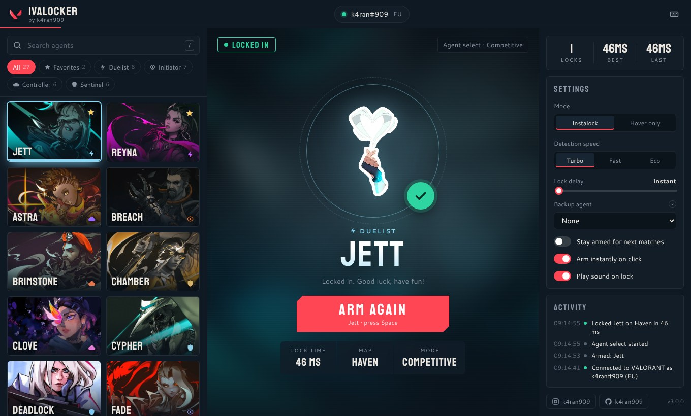

<div align="center">

  

  # iVALOCKER
  ### by [k4ran909](https://github.com/k4ran909)

  **The Fastest VALORANT Agent Instalocker**
  
  [](https://github.com/k4ran909/iVALOCKER/releases)
  [](https://github.com/k4ran909/iVALOCKER/releases/latest)
  [](LICENSE)

  <br>
  
  <a href="https://github.com/k4ran909/iVALOCKER/releases/latest">
    
  </a>

</div>

<br>

<p align="center">
  
</p>

## ⚡ Features

- **🚀 Faster locking**
  Watches your game state every **10 ms** and locks the moment agent select opens. Connections to Riot's servers are kept warm and only **2 requests** are needed per lock (it used to take 4), so the lock is only limited by your ping. Every lock time is shown in the app.

- **🔌 Plug & play**
  Start iVALOCKER before or after VALORANT, it doesn't matter. It finds the game automatically, detects your region, reconnects if the game restarts and refreshes your login token on its own.

- **🛟 Backup agent**
  If someone already took your main, iVALOCKER instantly locks your backup pick instead (right-click any agent to set it).

- **🔁 Stay armed**
  Optionally keep iVALOCKER armed so it locks your agent in every match, not just the next one. Switch agents at any time while armed.

- **⌨️ In-game hotkeys**
  Arm, stop and switch agents with global hotkeys (default F8 / F9) without alt-tabbing out of VALORANT. Fully rebindable.

- **🎛️ Modes & tuning**
  Instalock or *hover only* (select without locking), adjustable lock delay, three detection speeds (Turbo / Fast / Eco).

- **🎨 Brand new UI**
  Agent grid with role filters, favorites, typo-tolerant search and keyboard shortcuts. Shows your account and region, live game status (in menus / in queue / match found / agent select), lock time, map and mode, plus an activity log. Agents you don't own are marked.

- **🆕 Always up to date**
  New agents released by Riot show up automatically (via valorant-api.com), even before a new iVALOCKER release.

- **🛡️ Safe & secure**
  Only talks to the local Riot Client API and VALORANT's own agent select endpoints, the same ones the game uses. It does not read game memory or inject anything.

<br>

## 🎮 How to Use

1. **Download** from [Releases](https://github.com/k4ran909/iVALOCKER/releases/latest):
   - **`iVALOCKER_Setup_<version>.exe`** (recommended): **one-click install**. Double-click it and iVALOCKER installs, adds Start Menu + desktop shortcuts and opens. No questions, no admin rights. Uninstall from Settings > Apps; update by running a newer setup.
   - **`iVALOCKER_k4ran909.exe`**: portable single file, no install. Run it from anywhere.
2. **Run iVALOCKER** and **open VALORANT** (in any order). The pill at the top turns green with your Riot ID once connected.
3. **Click your agent.** iVALOCKER is now **ARMED** (turn off *Arm instantly on click* if you prefer to press the ARM button yourself).
4. **Queue for a match.** As soon as agent select appears, your agent is locked instantly.

**In-game hotkeys:** press **F8** to arm / stop and **F9** to switch to your next favorite agent, even while VALORANT is focused (you'll hear a beep). Change them, or add one to switch instalock / hover, in the *Hotkeys* panel: click a key box and press the new key.

> **Note:** Windows SmartScreen might warn you because the app is not signed. Click `More Info` > `Run Anyway`. This is normal for open-source tools.

### ⌨️ Shortcuts

| Key | Action |
| --- | --- |
| `/` | Search agents (`Enter` picks the first result) |
| `Space` | Arm / stop |
| `Esc` | Stop, or clear the search |
| `F` | Favorite the selected agent |
| `F8` (global, customizable) | Arm / stop, works while in game |
| `F9` (global, customizable) | Next favorite agent, works while in game |
| `1` - `6` | Filter: All, Favorites, Duelist, Initiator, Controller, Sentinel |
| Right-click an agent | Set / clear it as your backup agent |

<br>

## 🛠️ Building from Source

Requires **Python 3.9 or newer** (any version except 3.10.0) on Windows.

1. **Clone the repo**
   ```bash
   git clone https://github.com/k4ran909/iVALOCKER.git
   cd iVALOCKER
   ```

2. **Install dependencies** (or double-click `install.bat`)
   ```bash
   pip install -r requirements.txt
   ```

3. **Run it**
   ```bash
   python main.py            # add --debug to write a log to %LOCALAPPDATA%\iVALOCKER
   ```

4. **Build**
   ```bash
   python install_and_build/build.py               # portable exe  -> dist/iVALOCKER_k4ran909.exe   (or build.bat)
   python install_and_build/build.py --installer   # installer     -> dist/iVALOCKER_Setup_<version>.exe   (or build_installer.bat)
   ```
   Only Python is needed: if [Inno Setup](https://jrsoftware.org/isinfo.php) isn't installed, the build downloads a portable copy automatically.

5. **Release** (optional): push a tag like `v3.2` and GitHub Actions builds both files on Windows and publishes them as a GitHub Release.
   ```bash
   git tag v3.2 && git push origin v3.2
   ```

Run the tests with `pip install -r requirements-dev.txt` and `python -m pytest`.

<details>
<summary>Project layout</summary>

```
main.py              App entry point, connects the engine to the UI (Eel)
ivalocker/
  engine.py          Instalock state machine (connect, watch the game state, lock, backup pick)
  riot.py            Small client for the local Riot Client API + VALORANT's pregame API
  agents.py          Agent roster (bundled + live updates from valorant-api.com)
  hotkeys.py         Global hotkeys (Windows RegisterHotKey)
  settings.py        Saved preferences (%LOCALAPPDATA%\iVALOCKER\settings.json)
web/                 The UI (HTML / CSS / JS, agent artwork)
install_and_build/   install.py and build.py (portable exe / installer)
installer/           Inno Setup script for the Windows installer
tests/               Unit tests (pytest)
```
</details>

<br>

## ⚠️ Disclaimer

This software is for **educational purposes only**.
- I (k4ran909) am not responsible for any bans or suspensions. 
- While API abuse bans are extremely rare (and usually only 7 days if they happen), use this tool at your own risk.
- This tool is not affiliated with Riot Games or VALORANT.

<br>

## ❤️ Credits

- Built with [Eel](https://github.com/python-eel/Eel). The Riot API handling was originally based on [valclient](https://github.com/colinhartigan/valclient.py)
- Live agent data from [valorant-api.com](https://valorant-api.com)
- Inspired by various open-source instalockers
- Agent art and assets belong to Riot Games

<div align="center">
  <br>
  Designed & Maintained by <a href="https://github.com/k4ran909"><b>k4ran909</b></a>
</div>